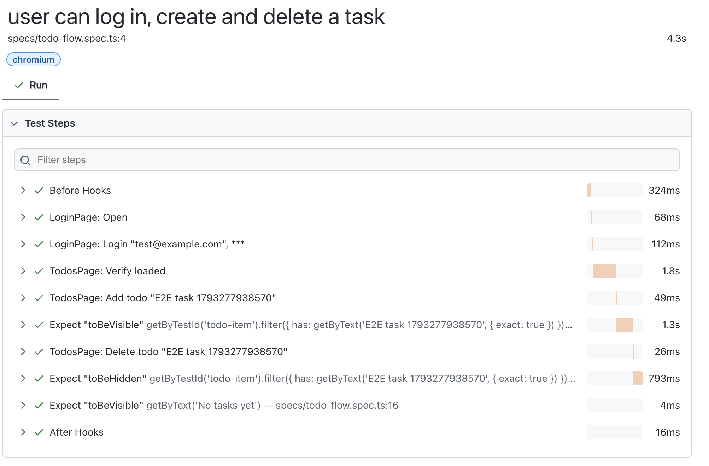

# qa-test-automation

Playwright + TypeScript E2E tests (Page Object Model) for a small todo app. The app under test (`src/`) was provided as part of a QA automation take-home task; the test framework in `tests/` is my work.

## What I changed

- **`@step` decorator** (`tests/utils/step.ts`): wraps page object methods in `test.step`, so the HTML report shows readable steps like `TodosPage: Add todo "E2E task ..."` instead of raw Playwright calls. Arguments are shown in the step name, passwords and tokens are masked as `***`, and steps are boxed so a failure points at the spec line.
- **`app` fixture** (`tests/fixtures/index.ts`, `tests/pages/Application.ts`): one entry point to all page objects. Tests take `{ app }` and call `app.loginPage` / `app.todosPage` instead of creating page objects by hand.
- **Simpler, clearer test**: page object methods only perform actions, and every verification lives in the spec, each checked once. Each run uses a unique task name (timestamp + random suffix), and todo items are matched by exact text.
- **Web-first assertions only**: removed non-retrying `count()` reads. All checks use auto-retrying assertions (`toBeVisible`, `toBeHidden`, `toHaveURL`).
- **Debuggable failures**: traces and screenshots are kept on failure. The old `trace: 'on-first-retry'` never recorded anything because retries are disabled.

How the `@step` decorator looks in the report:



A small "Todo list" app built with React + TypeScript (Vite) and a preconfigured Playwright setup.
There is no backend — all data is kept in browser memory and is reset when the page is reloaded.

## Requirements

- Node.js 18+ (20 or newer recommended)
- npm

## Installation

```bash
npm install
npx playwright install chromium
```

## Running the app

```bash
npm run dev
```

The app will be available at http://localhost:5173.

### Login credentials

| Field    | Value              |
| -------- | ------------------ |
| Email    | `test@example.com` |
| Password | `password123`      |

## Features

- `/` — login page: email, password and a "Log in" button. An error message is shown for invalid credentials.
- `/todos` — todo list (available only after logging in): add a task, delete a task, "Log out" button.

## Tests

Tests live in the `tests/` folder. Playwright starts the dev server itself (see `webServer` in `playwright.config.ts`),
so there is no need to run `npm run dev` separately.

```bash
npx playwright test            # run all tests (or npm test)
npx playwright test --ui       # interactive UI mode
npx playwright test --headed   # with a visible browser
npx playwright show-report     # open the HTML report of the last run
```

## Build

```bash
npm run build
```
